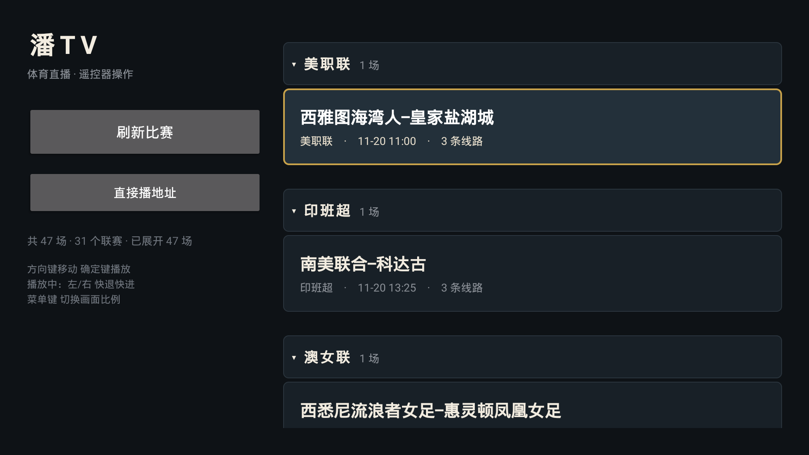
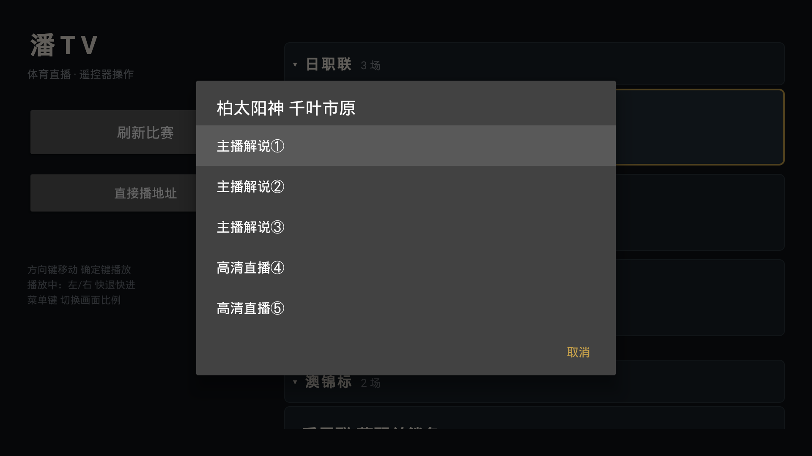

# 潘TV · Android TV 体育直播

给电视盒子用的直播客户端。已在 Sony BRAVIA（Android 9）实机跑通。





## 怎么用

```
遥控器方向键   在条目间移动（选中项有金色描边）
确定键         打开选中的比赛 / 选线路
返回键         退出播放或回上一页
菜单键         播放中切换画面比例
```

## 怎么用

```
遥控器方向键   在条目间移动（被选中项有黄色描边）
确定键         打开选中的直播
返回键         退出播放 / 浏览器后退
菜单键         播放中切换画面比例
```

首页有两个入口：**打开直播站**、**添加入口**（可粘贴任意 m3u8 / flv 地址）。

## 站点是怎么打通的

逆向那套动态接口不通（JS 混淆 + 主线程卡死），最后走的是「让站点自己在 WebView 里跑」这条路。实测链路：

```
比赛列表    https://m.jrs21.com/  里是普通 <a> 链接
播放按钮    <a href="http://play.<分流域名>/play/steamXXXXXX.html">
播放页      再嵌一层 iframe：sm.html?id=...
真实流      hdl3/hdl4.<流媒体域名>/<hash>/xxxxx.m3u8?token=...
```

App 做的三件事：

1. **注入导航**：给页面里所有可点元素加焦点环，方向键切换、确定键点击（电视没有触屏）
2. **顶层打开播放页**：拦下 `/play/` 链接，直接在本窗口加载，不让站点塞进 iframe——否则拿不到流
3. **截 m3u8**：`shouldInterceptRequest` 里识别媒体请求，交给原生 ExoPlayer 全屏播放，并带上 Referer / UA 绕防盗链

## 实测结果

```
点第一个「直播①」
  → 播放页加载
  → 截到 .m3u8（带 token）
  → 原生播放器全屏，硬件解码 1920×1080
```

## 为什么不做「自动抓节目单」

```
· 首页纯 JS 渲染，HTML 里没有比赛数据
· 播放地址脚本动态拼接，带 crypto-js 混淆
· 无头 Chrome 渲染时主线程被卡死，取 DOM 超时
```

硬做能出来，但站点一改版就废。内置浏览器跟真人走同一套流程，改版对它没影响。

## 已知限制

**一、流地址带 token**

每个 m3u8 的 token 有时效，所以不能把地址存成固定源——每次从站点点进去拿新的。这是设计使然。

**二、FLV 老源**

Media3 走 progressive 拉流，部分老 FLV 可能不兼容，报错会显示在播放器左上角。

**三、登录态**

需要登录的源可以在内置浏览器里登录，状态会保留（已开 localStorage）。

## 工程

```
app/src/main/java/com/pantv/sports/
  MainActivity.kt      入口列表、添加源
  BrowserActivity.kt   WebView + 方向键导航 + m3u8 拦截
  PlayerActivity.kt    ExoPlayer（HLS / FLV）
  ChannelStore.kt      本地存储
app/src/main/assets/sources.json   预置站点
```

编译：

```bash
export ANDROID_HOME=<SDK>
gradle assembleDebug
```

调试用：`adb forward tcp:9222 localabstract:webview_devtools_remote_<pid>`，可直接用 Chrome DevTools 看页面内情况。

## 如何更新这个仓库

正常情况直接用 git：

```bash
git add -A
git commit -m "改了什么"
git push
```

如果 `github.com` 的 HTTPS 连不上（表现为 `git push` 长时间无响应、`curl https://github.com` 超时），但 `api.github.com` 仍可访问，就走 API 提交：

```bash
node tools/push_api.mjs --files=README.md,app/src/main/java/com/pantv/sports/SiteService.kt --msg="改了什么"
```

脚本的流程是：上传 blob → 基于远端最新提交建树 → 建提交 → 移动 `main` 分支。它每次都读取远端 HEAD 作为父提交，所以不会产生冲突，也不依赖本地分支状态。

注意两点：

- 通过 API 提交后，本地与远端的提交 SHA 会不同（内容一致）。网络恢复后执行一次 `git fetch origin && git reset --hard origin/main` 即可并轨。
- 新增文件时要把路径写进 `--files`，删除文件则需要传 `sha: null` 的树条目，脚本目前只处理新增与修改。

